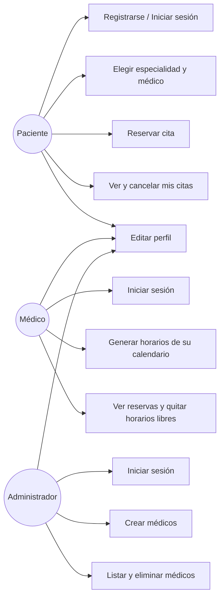
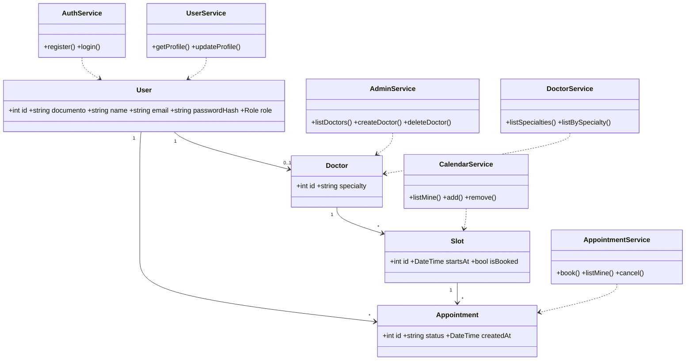
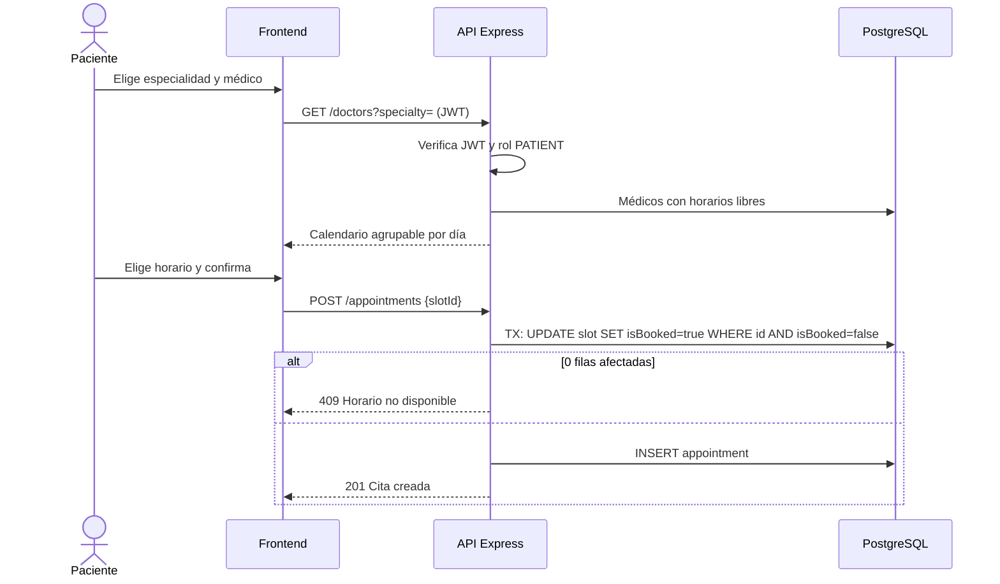
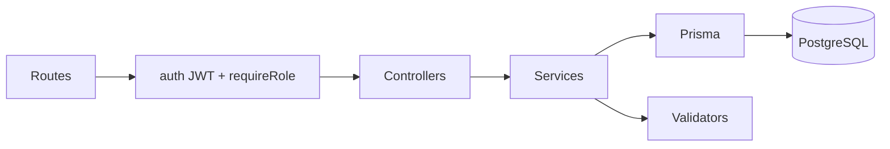
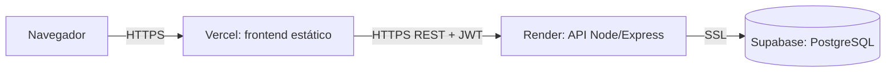

# Sistema de Citas Médicas (v3)

Stack: Node.js + Express + JWT + bcrypt + PostgreSQL (Prisma 5.22) · Frontend HTML/CSS/JS vanilla.

## 1. Requisitos

### Funcionales
| ID | Requisito | Rol |
|---|---|---|
| RF01 | Registro público (solo pacientes) e inicio de sesión. Documento y correo únicos; solo correos @fomag.co. | Todos |
| RF02 | Consultar médicos por especialidad y ver su calendario de horarios libres, agrupado por día. | Paciente |
| RF03 | Reservar una cita: primero se elige médico, luego un horario libre; el horario queda bloqueado para otros. | Paciente |
| RF04 | Ver las citas activas propias y cancelarlas (el horario se libera). | Paciente |
| RF05 | Consultar el perfil, cambiar el nombre y la contraseña. | Todos |
| RF06 | Gestionar el calendario: generar horarios por rango (fecha, desde, hasta, cada N minutos), ver cuáles están libres o reservados (y por qué paciente) y quitar los libres. | Médico |
| RF07 | Autorización por rol: cada ruta solo es accesible para el rol que corresponde (403 en caso contrario). | Sistema |
| RF08 | Crear, listar y eliminar médicos (con su especialidad). No se puede eliminar un médico con citas activas. | Administrador |

### Calidad (no funcionales)
| ID | Atributo | Requisito | Cómo se cumple |
|---|---|---|---|
| RNF01 | Seguridad | Rutas protegidas con JWT, contraseñas con bcrypt, autorización por rol, límite de intentos en login/registro, cabeceras seguras. | `auth.js`, `requireRole`, bcryptjs, express-rate-limit, helmet |
| RNF02 | Seguridad | Secretos fuera del código (variables de entorno) y CORS restringido al frontend. | `.env`, `FRONTEND_URL` |
| RNF03 | Integridad | Sin doble reserva ni datos duplicados, aun con peticiones simultáneas. | `updateMany` condicional en transacción; únicos en `email`, `documento` y `(doctorId, startsAt)` |
| RNF04 | Disponibilidad y despliegue | Arquitectura distribuida en la nube: frontend estático, API y base administrada. | Vercel + Render + Supabase |
| RNF05 | Usabilidad | Interfaz responsiva; el flujo de reserva se completa en 3 pasos tras autenticarse (especialidad, médico y horario, confirmar). | `style.css`, `index.html` |
| RNF06 | Mantenibilidad | Código en capas con responsabilidades separadas, de modo que agregar un rol o requisito no obligue a modificar lo existente. | routes → controllers → services → Prisma |
| RNF07 | Rendimiento | Las consultas de uso común responden en menos de 2 s (sin contar el arranque en frío del plan gratuito de Render). | Consultas indexadas por claves únicas |
| RNF08 | Validación | Toda entrada se valida en el servidor (documento 5-10 dígitos, correo @fomag.co, contraseña mínima, fechas futuras). | `utils/validators.js`, servicios |

## 2. Estructura
```
citas/
├── backend/
│   ├── index.js
│   ├── package.json
│   ├── .env.example
│   ├── prisma/ (schema.prisma, seed.js, createAdmin.js)
│   └── src/
│       ├── config/prisma.js
│       ├── middleware/ (auth.js, errorHandler.js)
│       ├── utils/validators.js
│       ├── services/ (Auth, Admin, Calendar, Doctor, Appointment, User)
│       ├── controllers/ (Auth, Admin, Calendar, Doctor, Appointment, User)
│       └── routes/index.js
└── frontend/ (index.html, style.css, app.js)
```

## 3. Ejecución local
```
cd backend
cp .env.example .env          # edita DATABASE_URL, JWT_SECRET, ADMIN_EMAIL, ADMIN_PASSWORD
npm install
npx prisma db push
npm run create-admin          # crea el administrador
npm run seed                  # (opcional) médicos de prueba: *@fomag.co / Doctor123
npm start
```

## 4. API
| Método | Ruta | Acceso |
|---|---|---|
| POST | /api/auth/register · /api/auth/login | Público |
| GET, PATCH | /api/users/me | Cualquier rol autenticado |
| GET | /api/doctors/specialties · /api/doctors?specialty= | PATIENT |
| POST, GET | /api/appointments | PATIENT |
| DELETE | /api/appointments/:id | PATIENT |
| GET, POST | /api/calendar/slots | DOCTOR |
| DELETE | /api/calendar/slots/:id | DOCTOR |
| GET, POST | /api/admin/doctors | ADMIN |
| DELETE | /api/admin/doctors/:id | ADMIN |

## 5. Despliegue
1. **Supabase**: usar el Session pooler como `DATABASE_URL`; ejecutar `db push` y `create-admin`.
2. **Render** (Root Directory `backend`): Build `npm install`, Start `node index.js`; variables `DATABASE_URL`, `JWT_SECRET`, `FRONTEND_URL`.
3. **Vercel**: cambiar `API_URL` en `frontend/app.js` y desplegar `frontend`.

## 6. Diagramas 4+1

### Escenarios


### Lógica


### Procesos (reserva)


### Desarrollo


### Física

